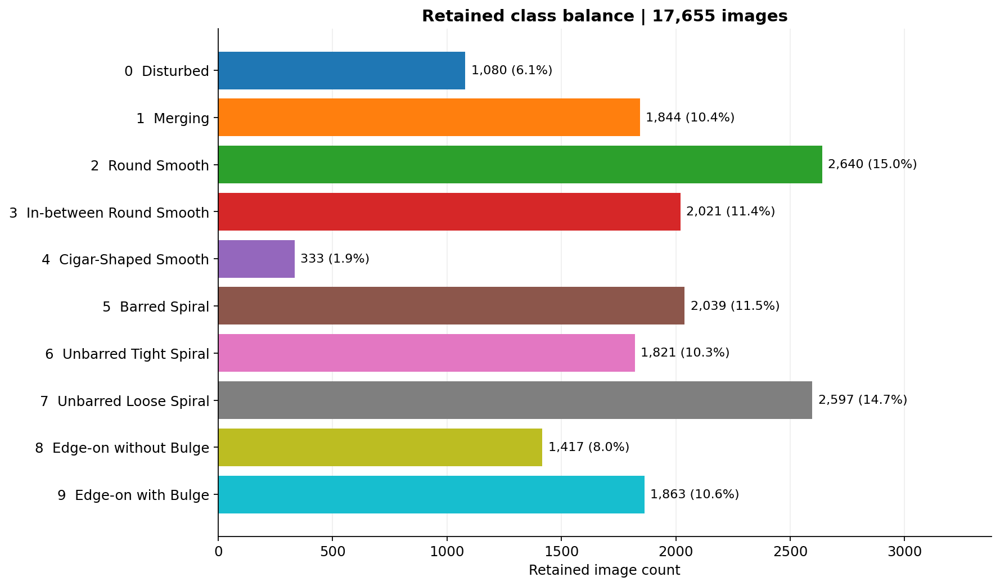
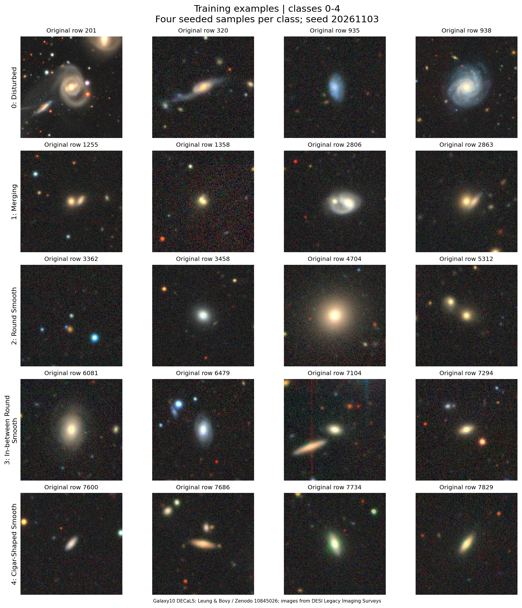
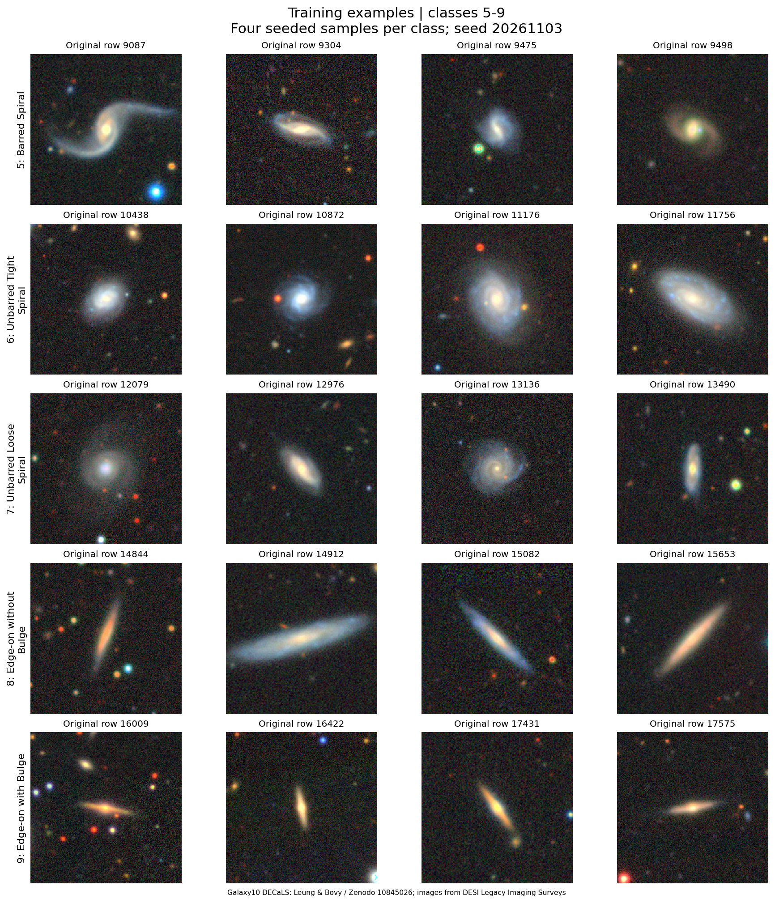
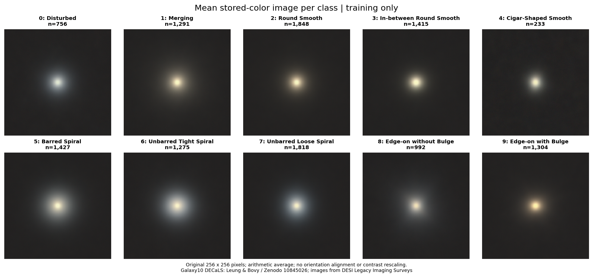
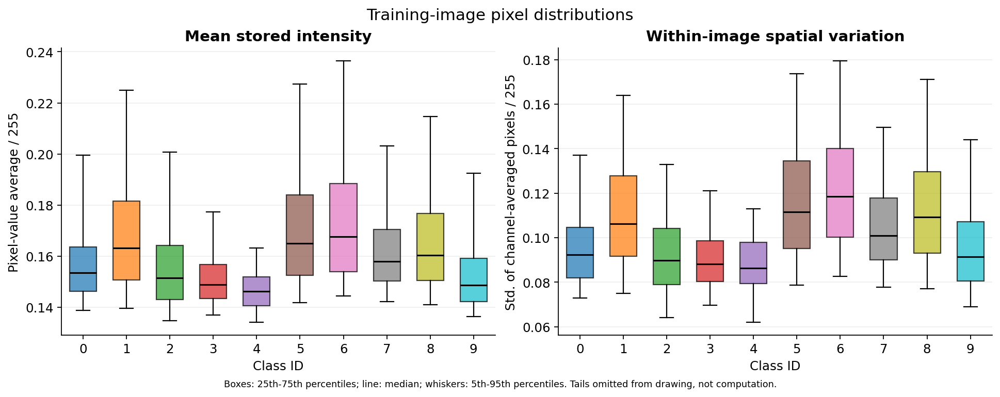
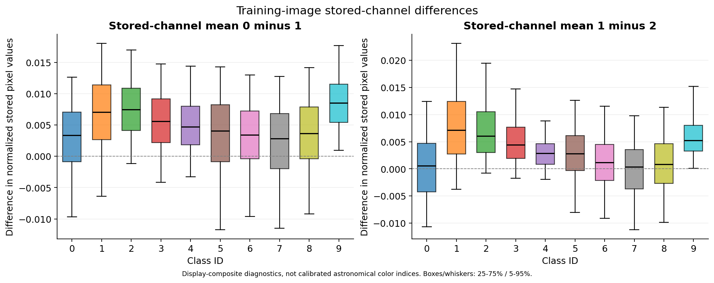
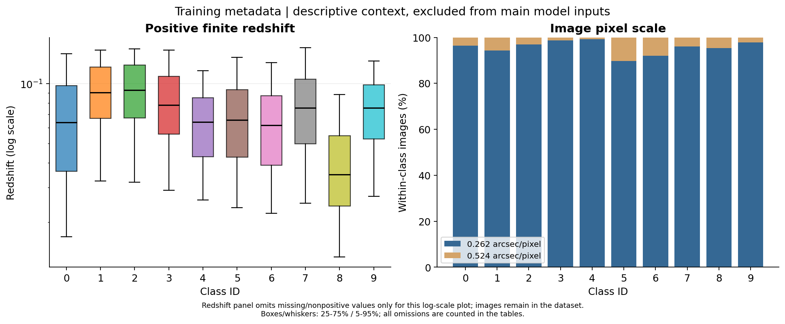

# Galaxy10 DECaLS: exploratory data analysis

This record describes the prepared v1 dataset and its training images. It contains no trained-model results.

## Questions and scope

How uneven are the classes? What do the images look like within each class? Do stored image values and metadata differ between classes? These checks inform later experiments; they do not establish classification performance or support the CNN-versus-transformer hypothesis.

The frozen dataset contains 17,655 retained images: 12,359 training, 2,650 validation, and 2,646 test. Every image-derived figure and numeric distribution below uses only the 12,359 training rows. Full-dataset class totals come from the frozen manifest; validation/test images are not used for exploratory statistics or gallery selection.

## Class balance

The largest retained class is 2 (Round Smooth, 2,640 images); the smallest is 4 (Cigar-Shaped Smooth, 333). Their size ratio is 7.93:1. Class 4 accounts for only 1.89% of retained images, so overall accuracy alone can hide poor minority-class performance. The planned macro F1 and per-class recall remain appropriate reporting choices.



| ID | Class | Retained | Train | Validation | Test |
| --- | --- | ---: | ---: | ---: | ---: |
| 0 | Disturbed | 1080 | 756 | 162 | 162 |
| 1 | Merging | 1844 | 1291 | 277 | 276 |
| 2 | Round Smooth | 2640 | 1848 | 396 | 396 |
| 3 | In-between Round Smooth | 2021 | 1415 | 303 | 303 |
| 4 | Cigar-Shaped Smooth | 333 | 233 | 50 | 50 |
| 5 | Barred Spiral | 2039 | 1427 | 306 | 306 |
| 6 | Unbarred Tight Spiral | 1821 | 1275 | 273 | 273 |
| 7 | Unbarred Loose Spiral | 2597 | 1818 | 390 | 389 |
| 8 | Edge-on without Bulge | 1417 | 992 | 213 | 212 |
| 9 | Edge-on with Bulge | 1863 | 1304 | 280 | 279 |

Counts sum to the frozen split exactly. Integer allocation causes small differences from exact 70/15/15 fractions; the split has not been changed for this analysis.

## Within-class examples

Four images per class were sampled without replacement from training using seed 20261103. Titles retain the original zero-based HDF5 row numbers. Sampling was not based on image quality, prediction difficulty, or model outputs. The gallery is a small sample, not proof that each class is visually separable or every label is correct.





The sampled cutouts include bright neighboring sources and targets with different apparent sizes; original rows 201, 3362 and 16009 illustrate this context. Whole-cutout intensity and channel averages therefore describe the target plus its background and neighbors. These examples do not estimate how common contamination is. No further exclusions or label changes were made after the split was frozen.

## Average images

Each panel is the arithmetic average of all training images in one class, at the original resolution and stored-color scale. Images are not rotated or aligned before averaging. Spiral details can therefore blur; the means summarize common spatial patterns and centering, rather than replace individual examples or demonstrate predictive features.



All ten displayed averages retain a bright central region. The mean images are much smoother than the individual examples, so an average image alone is insufficient evidence of class separability.

## Stored pixel distributions

Mean intensity is the average of all stored pixel-channel values divided by 255. Spatial variation is the population standard deviation of per-pixel channel averages, also divided by 255. Stored-channel differences subtract each image's normalized channel means. These are display-composite diagnostics, not calibrated fluxes, surface brightnesses, magnitudes, or physical g-r/r-z colors.

In this training sample, class 4 has the lowest median mean intensity (0.1462) and class 6 the highest (0.1676). This is a descriptive difference; acquisition, display rendering, background, pixel scale, and object properties are not isolated here. It cannot be interpreted as a causal effect of morphology.





Boxes span the 25th-75th percentiles, lines mark medians, and whiskers mark the 5th-95th percentiles. Tails are hidden from the drawing only; exported tables include minima and maxima. These intervals describe variation among images, not confidence intervals for a mean.

## Metadata context

Redshift counts in the training partition are: missing=64, negative=1, zero=1. These images remain included. The positive-redshift plot uses only finite values greater than zero because its vertical axis is logarithmic. The main comparison continues to exclude redshift and pixel scale from model inputs.



| Class ID | Train n | Missing z | Negative z | Zero z | Positive-z median |
| --- | ---: | ---: | ---: | ---: | ---: |
| 0 | 756 | 8 | 0 | 0 | 0.0639 |
| 1 | 1291 | 5 | 0 | 0 | 0.0902 |
| 2 | 1848 | 4 | 0 | 0 | 0.0928 |
| 3 | 1415 | 4 | 0 | 1 | 0.0782 |
| 4 | 233 | 0 | 0 | 0 | 0.0643 |
| 5 | 1427 | 8 | 1 | 0 | 0.0658 |
| 6 | 1275 | 3 | 0 | 0 | 0.0618 |
| 7 | 1818 | 7 | 0 | 0 | 0.0758 |
| 8 | 992 | 21 | 0 | 0 | 0.0349 |
| 9 | 1304 | 4 | 0 | 0 | 0.0755 |

Among positive finite training redshifts, class 8 has the lowest median (0.0349) and class 2 the highest (0.0928). These distributions overlap and do not by themselves explain morphology or demonstrate that metadata improve prediction.

Redshift and pixel-scale distributions provide context for potential dataset biases. They do not establish why classes differ. Finite sentinel codes and the physical meaning of individual nonpositive redshifts have not been independently verified.

## Reproduce and verify

From the repository root, with the original file under `data/raw/`:

```powershell
python -m pip install -r requirements-eda.txt
python eda.py
python validate_eda.py
```

The executed notebook `notebooks/01_exploration.ipynb` provides a walkthrough. Machine-readable results are under `docs/eda/tables/`; provenance, sampled row IDs and output hashes are in `docs/eda/summary.json`. Per-image diagnostics and average arrays are local under ignored `data/processed/eda_v1/`.

## Boundaries and next work

This completes the data-level exploration module. Hand-crafted feature extraction, feature/pretrained-representation UMAP plots, model training, prediction errors and the research hypothesis require later modules. No model has been evaluated, no test-set pixels inform these descriptive results, and no normalization or dimensionality-reduction estimator has been fitted for modeling.

The first-stage duplicate decisions were made using finite screening thresholds and Codex visual review; they do not prove that every duplicate or label error is absent. The team should independently verify the decisions and the interpretations recorded here.

## Sources and assistance

Data: W. Henry Leung and Jo Bovy, [Galaxy10 DECaLS, Zenodo record 10845026](https://zenodo.org/records/10845026), licensed under [CC BY 4.0](https://creativecommons.org/licenses/by/4.0/). The license ID was verified from the record's public API. Source images: DESI Legacy Imaging Surveys; class labels: Galaxy Zoo. Changes here include selecting and arranging training-image examples, resizing them for figure display, averaging images, and computing descriptive aggregates. See [the dataset documentation](https://astronn.readthedocs.io/en/latest/galaxy10.html) and [our preparation record](../DATA.md). Raw data are not uploaded.

EDA scripts, figures, the notebook and this exploratory record were produced with Codex assistance. Independent team verification has not been recorded. This is a generated exploratory record, not a statement that the team independently wrote or interpreted these materials.
