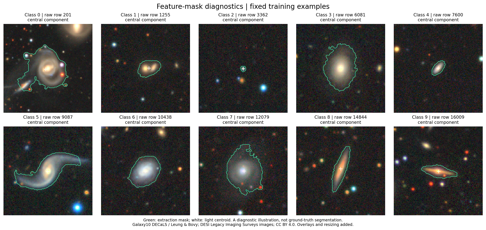
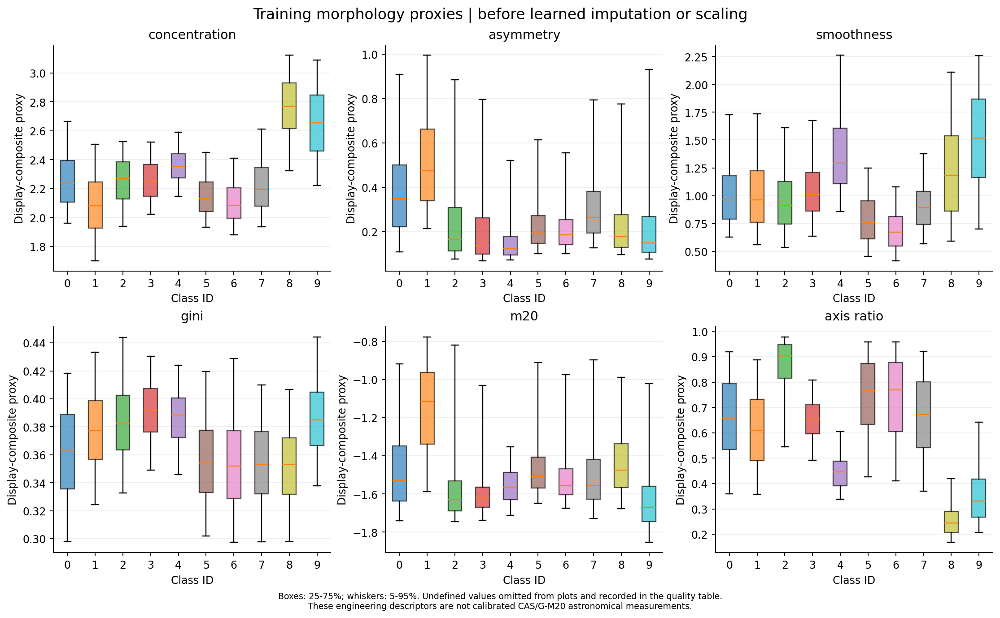
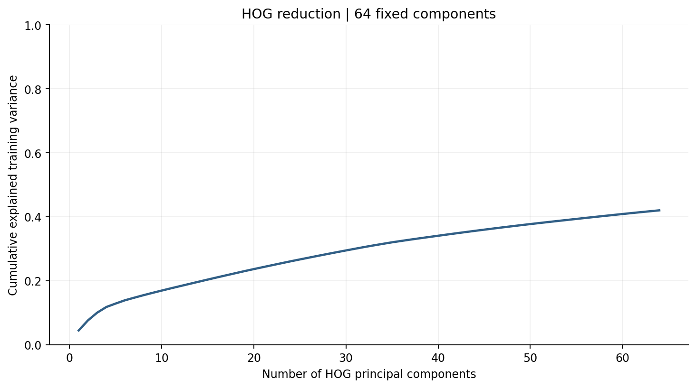
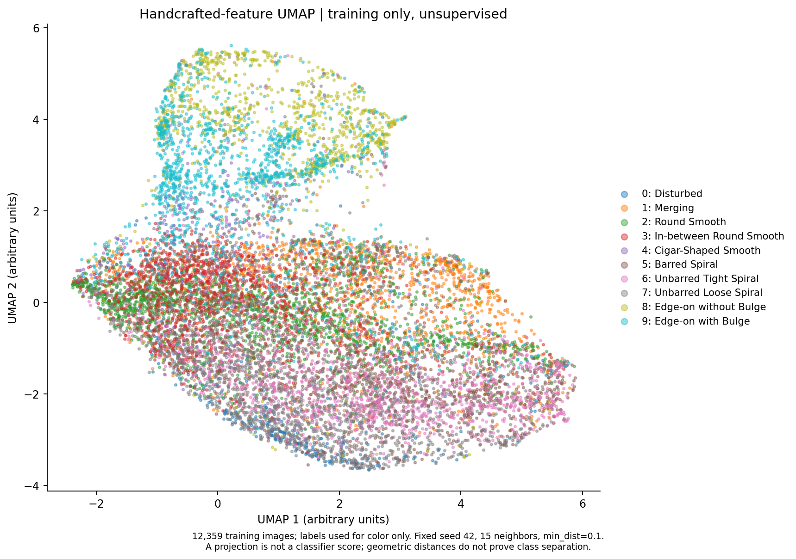

# Handcrafted image features: version 1

This module converts every retained image into a documented feature row and prepares a shared classical-model input. It fits image preprocessing and an unsupervised training projection, but trains no classifier and reports no prediction score.

## Data identity and outputs

The unchanged raw HDF5 and data-v1 split are reused. All **17,655 retained rows** have **54 scalar/quality descriptors plus 1764 HOG values**. After scalar imputation/scaling and 64-component HOG PCA/scaling, every row has **118 numeric inputs**. Metadata and labels are never input features.

| Partition | Rows | Processed inputs |
| --- | ---: | ---: |
| train | 12359 | 118 |
| validation | 2650 | 118 |
| test | 2646 | 118 |

Original zero-based HDF5 row IDs are retained separately from matrix positions. The large raw/processed matrices, scalar CSV and fitted transformer are local under ignored `data/processed/features_v1/`. Small schemas, configuration, provenance, quality summaries and fit-index records are versioned under `metadata/features_v1/`.

## Fixed image-only definitions

Definitions were fixed before feature extraction and before any classifier evaluation. The code accepts only 256 x 256 x 3 uint8 images. Stored channels are averaged in non-overlapping 2 x 2 blocks to form 128 x 128 color images. Their channel mean is the grayscale proxy. No redshift, pixel scale, sky coordinates, split ID, original row number or class label enters extraction.

- **Target mask:** estimate background by the median at radius >=56 pixels from the geometric center and noise by 1.4826 times its median absolute deviation. Smooth with sigma=1, detect above max(2.5 noise, 1/255) within radius 48, and choose the qualifying connected component nearest the center, with at least 16 pixels and intersection with the central radius-16 region. Fill holes. If none qualifies, use a radius-32 geometric-center aperture and set a fallback flag.
- **Color and stored-channel differences:** measure each channel mean/std and three pairwise difference mean/std in radius <=16 and 16<radius<=48 regions about the selected light centroid. Add center-minus-outskirts channel means and whole-frame channel mean/std. These are display-composite statistics, not physical g-r/r-z magnitude colors.
- **Concentration:** 5 log10(r80/r20), where radii enclose 20% and 80% of nonnegative segmented display light. Values at insufficient pixel resolution remain undefined and flagged.
- **Asymmetry:** normalized absolute difference from a 180-degree rotation about the segmented light centroid. The center is not optimized for minimum asymmetry and no blank-sky correction is applied.
- **Smoothness:** ten times the positive residual after sigma-3 Gaussian smoothing, outside a radius-2 core, divided by total segmented light. It is not the calibrated CAS clumpiness prescription.
- **Gini and M20:** finite-sample Gini over segmented nonnegative values; M20 is log10 of brightest >=20% cumulative-light second moment divided by the total moment about the light centroid. Zero-moment cases are undefined and flagged.
- **Shape and quality:** light-weighted axis ratio, elongation, eccentricity, flux radii, mask area, centroid offset, central light fraction, mean segmented signal and six explicit quality flags.
- **HOG:** 64 x 64 block-averaged grayscale, nine orientations, 8 x 8 pixels per cell, 2 x 2 cells per block, L2-Hys normalization, no square-root transform; 7 x 7 x 2 x 2 x 9 = 1,764 values. HOG is orientation-sensitive; no rotation-invariance claim is made.

These descriptors adapt concentration/asymmetry/smoothness and Gini/M20 ideas to rendered display composites. They are **morphology proxies**, not calibrated astronomical measurements: the data lack the calibrated pixel flux, uncertainty maps and standard Petrosian segmentation/background treatment needed to claim canonical CAS or G-M20 measurements. Central-target masking can still include neighbors or miss faint outskirts.



The mask gallery uses one preselected training example per class from the earlier seeded gallery, not examples selected to make extraction look successful. The overlay illustrates the implemented rule and can expose target-selection limitations; it is not ground-truth segmentation.

## Undefined values and quality

The training rows contain 0 undefined scalar entries across all descriptors. The fixed fallback aperture is used for 0 training images. Undefined quantities remain NaN in the raw table; no image is dropped and the frozen partition is unchanged. Flags are exported alongside numeric descriptors. See the per-feature training counts in `metadata/features_v1/training_quality.csv`.

The scalar preprocessing pipeline learns medians from training rows only, preserves an all-missing training column with a zero fill, then standardizes. This policy makes downstream matrices finite while retaining quality flags; it does not make the underlying undefined measurement valid.



The distributions are descriptive training summaries. Overlapping boxes or differences in medians are not classifier results and do not validate the astronomical interpretation of a proxy. Tails are omitted only from the plot; undefined-value counts are retained in the quality record.

## Training-only preprocessing and cross-validation

The scalar block uses median imputation then StandardScaler. The HOG block uses StandardScaler, randomized PCA with 64 fixed components and seed 42, then component-wise StandardScaler. Only the 12,359 frozen training IDs enter fit. Validation and test rows are transformed with that fitted instance; no held-out distribution or label is used to choose parameters.

The fixed 64 HOG components explain **42.03%** of standardized training HOG variance. The component count was fixed before this observation, not selected to reach a variance threshold.



**For future five-fold tuning, use raw descriptors with `make_model_pipeline(estimator)` from `galaxy_features.py`.** Put this entire pipeline inside GridSearchCV so imputation, scaling and PCA are refitted inside each training fold. Do not cross-validate the already transformed full-training exports: those are suitable for the eventual full-training fit and held-out inference, not leakage-free inner-fold evaluation.

```python
from galaxy_features import make_model_pipeline
# Pass RAW training descriptor rows to GridSearchCV(pipeline, ...).
pipeline = make_model_pipeline(estimator)  # estimator is supplied by the next module
```

## Training representation projection



UMAP is fitted without labels on the processed training features only: 15 neighbors, min_dist=0.1, Euclidean distance, two dimensions, 200 epochs, seed 42 and one worker. Labels only determine plotted colors. The projection is descriptive: visible islands, overlap or distances are not accuracy, significance, a class-separability guarantee or evidence for the CNN-versus-transformer hypothesis. Results depend on representation and projection settings. Pretrained-representation UMAP remains part of the later pretrained-model module.

## Reproduce and validate

Use the project feature environment, or install the pinned requirements into another Python 3.12 environment:

```powershell
python -m pip install -r requirements-features.txt
python build_features.py
python validate_features.py
python -m unittest discover -s tests -v
```

The local prepared environment can be invoked directly as `.venv\Scripts\python.exe`. `notebooks/02_handcrafted_features.ipynb` is the executed walkthrough. Raw descriptors can be cached only when extraction code, configuration, source identity and dependency versions match. Output hashes cover the local feature matrices and the tracked diagnostic artifacts. Existing data-v1 manifests and the earlier exploratory artifacts remain unchanged.

## Sources, attribution and assistance

- Conselice (2003), [The Relationship Between Stellar Light Distributions of Galaxies and their Formation Histories](https://arxiv.org/abs/astro-ph/0303065): motivation for concentration, asymmetry and clumpiness.
- Lotz, Primack & Madau (2004), [A New Non-Parametric Approach to Galaxy Morphological Classification](https://arxiv.org/abs/astro-ph/0311352): motivation for Gini and M20. The implementation above is an explicitly documented display-image adaptation.
- [scikit-image HOG](https://scikit-image.org/docs/0.25.x/api/skimage.feature.html#skimage.feature.hog), [scikit-learn leakage guidance](https://scikit-learn.org/stable/common_pitfalls.html#data-leakage), and [UMAP reproducibility](https://umap-learn.readthedocs.io/en/latest/reproducibility.html).
- W. Henry Leung & Jo Bovy, [Galaxy10 DECaLS](https://zenodo.org/records/10845026), CC BY 4.0; source images from DESI Legacy Imaging Surveys, labels from Galaxy Zoo. Display changes include resizing, mask overlays and derived aggregates.

Code, derived features, preprocessing, plots, notebook and this record were produced with Codex assistance. No independent team verification is recorded. No research classifier was trained or evaluated in this module.
